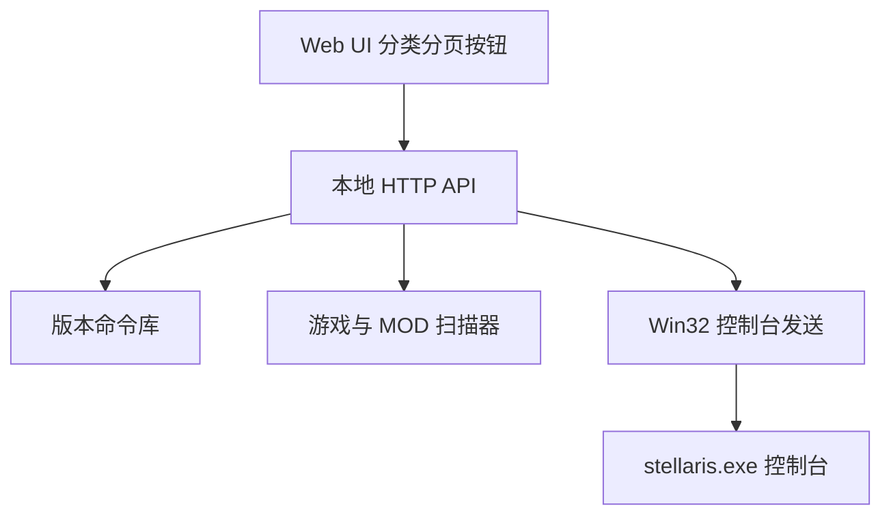

# Stellaris Console Panel

Feature Name: stellaris-console-panel
Updated: 2026-10-18

## Description

Windows 桌面工具：内置 3.0.0–4.4.6+ 原版命令库，可扫描游戏根目录与 MOD，分类分页按钮一键把控制台命令发送到正在运行的群星窗口。

## Architecture

程序以单 EXE 启动本地服务，用 Edge/Chrome `--app` 模式打开无地址栏窗口。发送链路：激活窗口 -> 开控制台 -> 选择输入通道（可扫码直接键入，否则整体走剪贴板）-> 回车。通道在按键前一次决定，避免半条命令已键入后再补粘贴造成重复。

## Components and Interfaces

- `cmd/panel`: 入口，嵌入前端，启动服务并打开窗口
- `internal/catalog`: 版本过滤、分类、分页
- `internal/scan`: 解析 Clausewitz 文本（舰船设计、巨构、事件）
- `internal/send`: Windows FindWindow / SendInput / 剪贴板粘贴
- `cmd/setup`: 自包含标准安装器。`go:embed` 内嵌主程序，运行时 UAC 提权、复制文件、经 PowerShell COM 建快捷方式、写 Uninstall 注册表项，支持 `/S` 静默与 `/uninstall` 卸载

## Data Models

每条命令包含：`id`, `name_zh`, `name_en`, `command`, `category`, `since`, `until`, `source`, `note`。

版本选择后只保留 `since <= version <= until` 的条目。内置条目 `source=vanilla`；扫描结果 `source=mod`（原版扫描为 `vanilla`）进入 MOD 分类。扫描条目的 `since` 固定为 `3.0.0`，因为 MOD 内容与应用目标版本无强绑定，版本号只写入备注。

## Design Decisions

- **扫描去重**：扫描结果若与内置库命令重复则丢弃，保证同一条真实命令只有一个按钮。
- **事件筛选**：事件必须有本地化标题（中文或英文）才保留；否则只得到无法辨认的内部 ID，属于噪音。
- **舰船尺寸**：`ship_size` 只在 `name` 之后的同一设计块内向后查找，避免误取上一条设计的尺寸。
- **设置合并**：保存设置时以当前值为基底解码，缺省字段（如旧客户端未提交 `extra_mods`）不会被清空；路径去引号并校验版本与开控制台键。
- **发送串行化**：`/api/send` 与 `/api/open_console` 共用互斥锁，并发点击不会交错按键。
- **前端分页**：每页数量在客户端按 `cols×rows` 计算并夹到服务端上限 800，两侧页边界保持一致。
- **构建版本**：仓库根 `VERSION` 为单一事实来源，`build.sh` 通过 `-ldflags -X main.appVersion` 注入主程序与安装器。

## Correctness Properties

- 同一 `command` 在同一分类下去重；扫描结果不与内置命令重复
- 发送时完整写入一行后回车，不拆分中文名
- 输入通道在敲键前确定，不会出现前缀重复
- 扫描失败不影响内置库
- 并发发送请求串行执行，按键不会交错
- 客户端与服务端页大小一致，翻页不重复也不跳条

## Error Handling

- 找不到群星窗口：提示启动游戏并关闭铁人模式
- 命令无法用 US 扫码输入：整体走剪贴板，并在失败时返回明确错误
- 窗口无法置前：返回提示，要求先点一下游戏画面
- 路径无效或没有可扫描目录：返回 400，保留上次成功扫描结果
- 设置写入原子替换（临时文件 + rename），避免崩溃时配置被截断

## Test Strategy

- catalog 版本过滤、排序、扫描去重单元测试
- Clausewitz 扫描器样例测试（装饰过滤、事件标题要求、扫描条目版本可见性）
- 设置归一化与命令校验单元测试
- Host/Origin 校验与 JSON Content-Type 约束测试
- Linux 下用浏览器预览 UI；Windows 下验证发送链路
