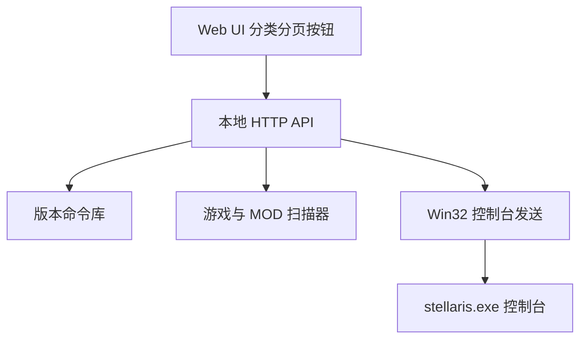

# Stellaris Console Panel

Feature Name: stellaris-console-panel
Updated: 2026-10-12

## Description

Windows 桌面工具：内置 3.0.0–4.4.6+ 原版命令库，可扫描游戏根目录与 MOD，分类分页按钮一键把控制台命令发送到正在运行的群星窗口。

## Architecture

程序以单 EXE 启动本地服务，用 Edge/Chrome `--app` 模式打开无地址栏窗口。发送链路：激活窗口 -> 开控制台 -> 粘贴命令 -> 回车。

## Components and Interfaces

- `cmd/panel`: 入口，嵌入前端，启动服务并打开窗口
- `internal/catalog`: 版本过滤、分类、分页
- `internal/scan`: 解析 Clausewitz 文本（舰船设计、巨构、事件）
- `internal/send`: Windows FindWindow / SendInput / 剪贴板粘贴
- `cmd/setup`: 自包含标准安装器。`go:embed` 内嵌主程序，运行时 UAC 提权、复制文件、经 PowerShell COM 建快捷方式、写 Uninstall 注册表项，支持 `/S` 静默与 `/uninstall` 卸载

## Data Models

每条命令包含：`id`, `name_zh`, `name_en`, `command`, `category`, `since`, `until`, `source`, `note`。

版本选择后只保留 `since <= version <= until` 的条目。扫描结果 `source=mod` 进入 MOD 分类。

## Correctness Properties

- 同一 `command` 在同一分类下去重
- 发送时完整写入一行后回车，不拆分中文名
- 扫描失败不影响内置库

## Error Handling

- 找不到群星窗口：提示启动游戏并关闭铁人模式
- 剪贴板或 SendInput 失败：回退逐键发送
- 路径无效：保留上次成功扫描缓存

## Test Strategy

- catalog 版本过滤单元测试
- Clausewitz 扫描器样例测试
- Linux 下用浏览器预览 UI；Windows 下验证发送链路
