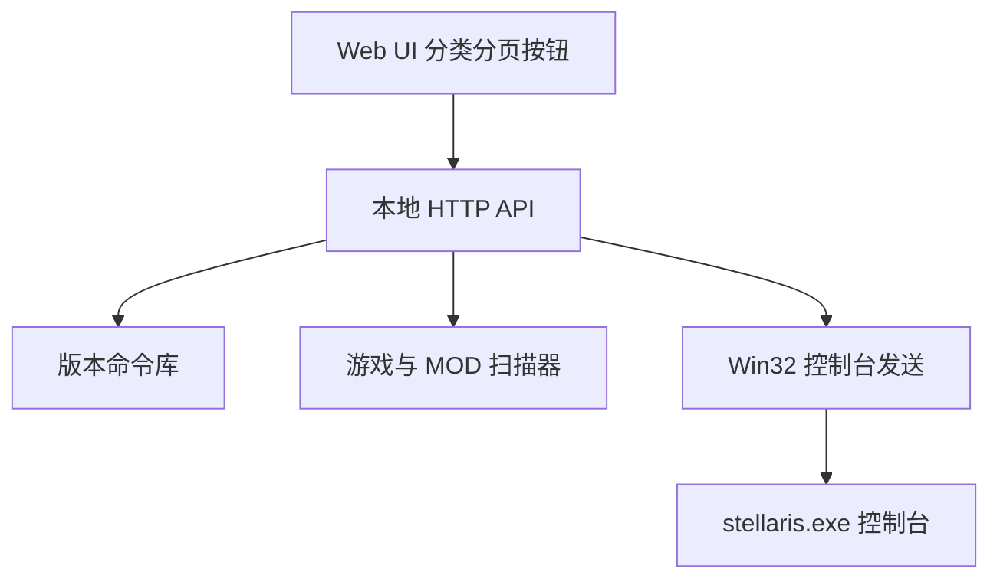

# Stellaris Console Panel

Feature Name: stellaris-console-panel
Updated: 2026-10-31

## Description

Windows 桌面工具：内置 3.0.0–4.5.0 原版命令库，可扫描游戏根目录与 MOD，分类分页按钮一键把控制台命令发送到正在运行的群星窗口。

## Architecture

程序以单 EXE 启动本地服务，用 Edge/Chrome `--app` 模式打开无地址栏窗口。发送链路：激活窗口 -> 开控制台 -> 选择输入通道（可扫码直接键入，否则整体走剪贴板）-> 回车。通道在按键前一次决定，避免半条命令已键入后再补粘贴造成重复。

## Components and Interfaces

- `cmd/panel`: 入口，嵌入前端，启动服务并打开窗口
- `internal/catalog`: 版本过滤、分类、分页
- `internal/scan`: 解析 Clausewitz 文本（舰船设计、巨构、事件）
- `internal/send`: Windows FindWindow / SendInput / 剪贴板粘贴
- `cmd/setup`: 自包含标准安装器。`go:embed` 内嵌主程序，运行时 UAC 提权、复制文件、经 PowerShell COM 建快捷方式、写 Uninstall 注册表项，支持 `/S` 静默与 `/uninstall` 卸载

## Data Models

每条命令包含：`id`, `name_zh`, `name_en`, `command`, `category`, `since`, `until`, `source`, `note`, `scope`, `target`, `target_mode`, `dlc`, `lore`, `target_hint`, `pre_commands`。

版本选择后只保留 `since <= version <= until` 的条目。内置条目 `source=vanilla`。扫描原版文件时 `source=vanilla`，分类仍是建造舰船/巨构/事件危机；与任意内置命令重复则丢弃。扫描 MOD 时 `source=mod:...`，分类为 `MOD扫描`。扫描条目的 `since` 固定为 `3.0.0`，版本号只写入备注。

## Design Decisions

- **扫描去重**：扫描结果若与内置库命令重复则丢弃，保证同一条真实命令只有一个按钮。
- **事件筛选**：事件必须有本地化标题（中文或英文）才保留；否则只得到无法辨认的内部 ID，属于噪音。
- **舰船尺寸**：`ship_size` 只在 `name` 之后的同一设计块内向后查找，避免误取上一条设计的尺寸。
- **设置合并**：保存设置时以当前值为基底解码，缺省字段（如旧客户端未提交 `extra_mods`）不会被清空；路径去引号并校验版本与开控制台键。
- **发送串行化**：`/api/send` 与 `/api/open_console` 共用互斥锁，并发点击不会交错按键。
- **前端分页**：每页数量在客户端按 `cols×rows` 计算并夹到服务端上限 800，两侧页边界保持一致。
- **构建版本**：仓库根 `VERSION` 为单一事实来源，`build.sh` 通过 `-ldflags -X main.appVersion` 注入主程序与安装器。
- **前置条件标注**：条目携带 `scope`、`target`、`target_mode`、`dlc`、`pre_commands`。国家事件无需选中；星球、舰队、领袖、恒星基地、局势、星系事件需先选中对应对象；舰船事件与数字目标命令会把右上角 ID 写入命令，未填有效数字时前端拦截。`annex` / `kill_country` / `force_integrate` 的 `target_mode=optional`，仅在 ID 非 0 时写入。
- **前置命令链**：`pre_commands` 先逐条输入并回车，再输入所选命令；链内后续命令 `SkipOpen=true`。
- **DLC 标签**：内置条目按命令/事件/舰船/巨构映射官方中文 DLC 名（启示录、纵横捭阖、四海皆臣、至臻完人、上古之遗、风起云涌、博物天枢、万物竞发、虚境幽影、灭世天罚、星界位面等）。
- **舰船生成**：`add_ship` 在选中目标旁生成舰船，所有此类条目标注 `selected`。
- **版本校验**：扫描游戏根目录时解析 `events/` 中的 `*_event` 作用域与 `common/global_ship_designs`、`common/ship_designs` 的设计名；内置事件 ID 或 `NAME_` 设计不存在时标为 `missing`，可用 `hide_missing=1` 过滤。仅扫描 MOD 时不校验内置条目。

## Correctness Properties

- 内置库跨分类命令唯一；扫描结果与任意内置命令重复则丢弃，扫描结果内部按分类+命令去重
- 发送时完整写入一行后回车，不拆分中文名
- 输入通道在敲键前确定，不会出现前缀重复
- 扫描失败不影响内置库
- 并发发送请求串行执行，按键不会交错
- 客户端与服务端页大小一致，翻页不重复也不跳条
- 需要数字目标的命令在目标 ID 不是数字时不会发送；默认玩家为 0
- 版本校验只在内置条目的 ID/设计确实缺失时标记，避免误判玩家自定义设计

## Error Handling

- 找不到群星窗口：提示启动游戏并关闭铁人模式
- 命令无法用 US 扫码输入：整体走剪贴板，并在失败时返回明确错误
- 窗口无法置前：返回提示，要求先点一下游戏画面
- 路径无效或没有可扫描目录：返回 400，保留上次成功扫描结果
- 设置写入原子替换（临时文件 + rename），避免崩溃时配置被截断

## Test Strategy

- catalog 版本过滤、排序、扫描去重单元测试
- Clausewitz 扫描器样例测试（装饰过滤、事件标题要求、扫描条目版本可见性）
- 设置归一化与命令校验单元测试
- Host/Origin 校验与 JSON Content-Type 约束测试
- Linux 下用浏览器预览 UI；Windows 下验证发送链路
